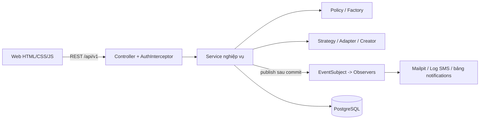
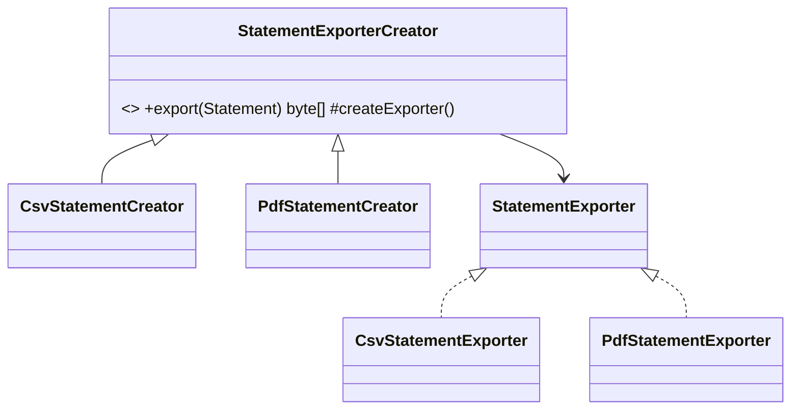

# Internal Wallet — Ví điện tử nội bộ

Đồ án môn **Design Patterns**: ứng dụng ví điện tử nội bộ (giao diện web + REST API Java Spring Boot + PostgreSQL), dùng để minh họa việc áp dụng các mẫu thiết kế GoF vào một bài toán nghiệp vụ có tiền, giao dịch và đồng thời.

> Đây là ứng dụng học tập/mô phỏng, không phải sản phẩm ngân hàng thực. Lãi suất, phí và hạn mức chỉ mang tính minh họa.

## Mục lục

1. [Tổng quan đồ án](#1-tổng-quan-đồ-án)
2. [Mẫu thiết kế (Design Pattern)](#2-mẫu-thiết-kế-design-pattern)
3. [Các pattern được áp dụng trong đồ án](#3-các-pattern-được-áp-dụng-trong-đồ-án)
4. [Kết luận và hướng phát triển](#4-kết-luận-và-hướng-phát-triển)
5. [Khởi chạy, kiểm thử và tài liệu](#5-khởi-chạy-kiểm-thử-và-tài-liệu)

---

## 1. Tổng quan đồ án

### 1.1. Giới thiệu

Internal Wallet cho phép người dùng nội bộ có ví điện tử, chuyển tiền cho nhau, xem lịch sử, xuất sao kê, nhập và thống kê chi tiêu, đồng thời quản trị viên cấp tiền và đối soát số dư. Hệ thống ưu tiên **tính đúng đắn của tiền**: số dư là số nguyên VND (`BIGINT`), mọi biến động đều có bút toán sổ cái, chuyển tiền có khóa chống trùng (`requestKey`) và được bảo vệ bằng transaction, khóa dòng theo thứ tự cố định để tránh deadlock.

**Công nghệ**

| Lớp | Công nghệ |
| --- | --- |
| Backend | Java 25, Spring Boot 4.1.1 (Web MVC, JDBC, Actuator, Mail), `JdbcTemplate` (không dùng ORM) |
| CSDL | PostgreSQL 17, migration bằng Flyway (V1–V11) |
| Bảo mật | BCrypt (`spring-security-crypto`), token phiên lưu dạng hash, giới hạn tần suất đăng nhập |
| Báo cáo | Apache Commons CSV, Apache PDFBox 3 (PDF font Unicode) |
| Giao diện | HTML/CSS/JavaScript thuần (không bước build), Chart.js tự host, Inter font, chế độ sáng/tối, đạt WCAG AA |
| Hạ tầng | Docker Compose (API + PostgreSQL + Mailpit), GitHub Actions CI |
| Kiểm thử | JUnit 5, Testcontainers (PostgreSQL thật) — 49 ca kiểm thử + benchmark |

**Cấu trúc mã nguồn** (`src/main/java/vn/edu/wallet`)

```
api/       Controller REST, DTO, xử lý lỗi thống nhất
auth/      Đăng ký/đăng nhập, AuthInterceptor, rate limit, dọn phiên hết hạn
core/      Quy tắc chuyển tiền thuần (TransferRules), Money, mã lỗi
account/   AccountFactory (+3 factory), AccountPolicy (+3 policy)  ← Factory Method / Policy
service/   TransferService, AccountService, SavingsService, CreditService, GrantService,
           AccountFeeService, ReconciliationService
expense/   ExpenseCsvAdapter (+2 adapter), ExpenseAggregationStrategy (+2 strategy)  ← Adapter / Strategy
report/    StatementExporterCreator (+2 creator), StatementExporter (+2 exporter)    ← Factory Method
notify/    EventSubject, NotificationObserver (+3 observer), LowBalanceMonitor, ReminderService  ← Observer
```

### 1.2. Chức năng

**Người dùng (USER)**

- **Tài khoản & xác thực:** đăng ký, đăng nhập, đăng xuất (thu hồi phiên). Mỗi người có một tài khoản *Thanh toán* mặc định (số dư 0) và có thể mở thêm.
- **Ba loại tài khoản:**
  - *Thanh toán* — chuyển/nhận tiền, phí duy trì 5.000 VND/tháng.
  - *Tiết kiệm* — gửi từ Thanh toán của chính mình, kỳ hạn 90 ngày, lãi minh họa 4%/năm; rút trước hạn mất phí 0,5% gốc.
  - *Tín dụng (mô phỏng)* — hạn mức do ADMIN cấp, ghi khoản sử dụng/hoàn trả từ Thanh toán, phí thường niên 20.000 VND.
- **Chuyển tiền:** tra cứu mã ví, xác nhận, chuyển tiền idempotent theo `requestKey`, thử lại an toàn khi timeout.
- **Lịch sử & sao kê:** xem giao dịch có phân trang; xuất sao kê **CSV hoặc PDF** (toàn bộ hoặc từng phần 500 giao dịch).
- **Chi tiêu:** nhập khoản chi từ CSV (xem trước → xác nhận, báo lỗi theo dòng, chống nhập trùng), thống kê theo **danh mục** hoặc **tháng** kèm biểu đồ. Dữ liệu chi tiêu tách biệt với số dư ví.
- **Thông báo & nhắc nhở:** thông báo trong ứng dụng, email (Mailpit), SMS mô phỏng; cảnh báo số dư thấp theo ngưỡng tự cấu hình; nhắc phí chưa thu, dư nợ tín dụng, tiết kiệm sắp đáo hạn.
- **Phí tự động:** tác vụ UTC hằng ngày tạo và thu phí đến hạn; thiếu tiền thì giữ `DUE` để thử lại, không khóa đăng nhập.

**Quản trị viên (ADMIN)**

- Cấp tiền vào ví (idempotent theo `requestKey`, có lý do và vết kiểm toán).
- Cấp hạn mức cho tài khoản Tín dụng.
- **Đối soát:** so khớp `wallets.balance_dong` với tổng `ledger_entries` của từng ví, báo sai lệch (không tự sửa).

Chi tiết: [Hướng dẫn sử dụng](docs/huong-dan-su-dung.md) · [API](docs/api.md) · [Quy tắc tài khoản và phí](docs/account-types.md).

### 1.3. Kiến trúc tổng thể



Kiến trúc phân lớp: *Controller* chỉ xác thực, kiểm tra đầu vào và ủy quyền; *Service* giữ transaction và quy tắc; các pattern nằm ở ranh giới nơi **hành vi thay đổi theo loại/định dạng/kênh**. Xem thêm [docs/architecture.md](docs/architecture.md).

---

## 2. Mẫu thiết kế (Design Pattern)

### 2.1. Giới thiệu

Design Pattern là lời giải đã được kiểm chứng cho các vấn đề thiết kế lặp lại trong hướng đối tượng, được hệ thống hóa bởi nhóm "Gang of Four" (GoF, 23 mẫu). Pattern không phải đoạn mã dùng lại nguyên xi mà là **khuôn mẫu cấu trúc** (các lớp, giao diện, mối quan hệ) giúp mã dễ mở rộng, giảm phụ thuộc và có chung từ vựng giữa các lập trình viên. GoF chia thành ba nhóm:

| Nhóm | Mục đích | Ví dụ |
| --- | --- | --- |
| Creational (khởi tạo) | Tách việc tạo đối tượng khỏi việc dùng | Factory Method, Abstract Factory, Singleton, Builder |
| Structural (cấu trúc) | Ghép lớp/đối tượng thành cấu trúc lớn hơn | Adapter, Decorator, Facade, Composite |
| Behavioral (hành vi) | Phân chia trách nhiệm và giao tiếp giữa đối tượng | Strategy, Observer, Command, Template Method |

### 2.2. Kiến trúc của bốn pattern được dùng

**Factory Method (Creational)** — Một lớp *Creator* khai báo phương thức `createProduct()`; các *ConcreteCreator* ghi đè để tạo *ConcreteProduct*. Creator chứa quy trình chung và chỉ làm việc với giao diện *Product*.

```
Creator ──(factoryMethod)──> Product <|── ConcreteProductA/B
   ▲
ConcreteCreatorA/B  (override factoryMethod)
```

**Adapter (Structural)** — Chuyển giao diện không tương thích của nguồn (*Adaptee*) thành giao diện đích (*Target*) mà client mong đợi.

```
Client ──> Target <|── Adapter ──> Adaptee
```

**Strategy (Behavioral)** — Đóng gói một họ thuật toán sau cùng một giao diện, cho phép thay thế lúc chạy mà không đổi *Context*.

```
Context ──> Strategy <|── ConcreteStrategyA/B
```

**Observer (Behavioral)** — *Subject* giữ danh sách *Observer* và thông báo khi có sự kiện; hai phía chỉ biết nhau qua giao diện, quan hệ một–nhiều.

```
Subject o──> Observer <|── ConcreteObserverA/B/C
```

Ngoài ra đồ án dùng **Policy** (biến thể của Strategy gắn với loại tài khoản) để kiểm soát quyền thao tác theo loại.

---

## 3. Các pattern được áp dụng trong đồ án

Tóm tắt:

| # | Pattern | Vị trí trong mã | Vấn đề giải quyết |
| --- | --- | --- | --- |
| 1 | Factory Method | `report/` — xuất sao kê CSV/PDF | Hai định dạng, cùng quy trình xuất |
| 2 | Adapter | `expense/` — nhập CSV chi tiêu | Nhiều cấu trúc CSV → một mô hình dữ liệu |
| 3 | Strategy | `expense/` — thống kê | Hai cách nhóm thay thế được |
| 4 | Observer | `notify/` — thông báo | Nhiều kênh nhận sự kiện, không ràng buộc nghiệp vụ |
| 5 | Factory Method + Policy | `account/` — loại tài khoản | Tạo tài khoản và quy tắc giao dịch theo loại |

### 3.1. Factory Method — xuất sao kê

- **Vị trí:** `report/StatementExporterCreator` (Creator trừu tượng) → `CsvStatementCreator`, `PdfStatementCreator` (ConcreteCreator); `StatementExporter` (Product) → `CsvStatementExporter`, `PdfStatementExporter`. Được gọi từ `StatementService` / `StatementController` (`GET /api/v1/statements?format=csv|pdf`).
- **Cách áp dụng:** `StatementExporterCreator.export()` là quy trình chung (kiểm tra sao kê → tạo luồng → ghi → trả `byte[]`) và gọi factory method `createExporter()`; mỗi Creator con trả exporter của định dạng mình.
- **Kết quả:** xuất đúng tệp CSV UTF-8 hoặc PDF font Unicode, cùng dữ liệu `Statement`. Kiểm thử tích hợp xác nhận ghép các phần CSV bằng với bản xuất toàn bộ; checksum SHA-256 CSV/PDF không đổi sau khi tối ưu truy vấn.
- **Vì sao:** hai định dạng khác cách ghi nhưng giống quy trình. Thêm định dạng mới (XLSX…) chỉ cần thêm cặp Creator/Exporter, không sửa mã hiện có (Open/Closed), không có chuỗi `if/switch` định dạng rải rác.



### 3.2. Adapter — nhập CSV chi tiêu

- **Vị trí:** `expense/ExpenseCsvAdapter` (Target) → `SampleFormatACsvAdapter` (`date,description,category,amount_vnd`), `SampleFormatBCsvAdapter` (`Ngày,Nội dung,Danh mục,Số tiền`, đọc cả bản cũ phân cách `;`); client là `ExpenseImportService`; mô hình đích `ImportedExpense`/`CsvPreview`.
- **Cách áp dụng:** mỗi adapter chuyển một cấu trúc CSV thành danh sách `ImportedExpense` thông qua bộ phân tích chung `ExpenseCsvParsing`; `preview()` trả dòng hợp lệ và lỗi theo dòng mà chưa ghi CSDL, `read()` chỉ chạy khi mọi dòng hợp lệ.
- **Kết quả:** `POST /expense-imports/preview` hiển thị lỗi theo dòng; `POST /expense-imports` ghi `import_batches` + `imported_expenses`, chống nhập trùng theo UUID/hash nội dung, **không đổi** `wallets` hay `ledger_entries`.
- **Vì sao:** phần lưu trữ và thống kê chỉ hiểu một mô hình; thêm định dạng nguồn mới (sao kê của ngân hàng khác) chỉ cần thêm adapter mà không đụng nghiệp vụ.

### 3.3. Strategy — tổng hợp thống kê

- **Vị trí:** `expense/ExpenseAggregationStrategy` → `ByCategoryStrategy`, `ByMonthStrategy`; Context là `ExpenseStatisticsService` (`GET /expense-stats?groupBy=category|month`).
- **Cách áp dụng:** mỗi strategy cung cấp biểu thức nhóm SQL cố định (`sqlKeyExpression()`), PostgreSQL tính `SUM/COUNT`; `aggregate()` giữ phép nhóm trong bộ nhớ làm tham chiếu kiểm thử tương đương.
- **Kết quả:** trên 80.000 dòng, thống kê theo danh mục giảm từ **507 ms → 57 ms**, theo tháng **470 ms → 58 ms** mà kết quả giữ nguyên (checksum trùng) — xem [docs/performance.md](docs/performance.md).
- **Vì sao:** thuật toán nhóm thay đổi theo yêu cầu (`groupBy`) nhưng khung xử lý (chọn khoảng ngày, truy vấn, sắp xếp) không đổi; Strategy giúp thêm cách nhóm (theo tuần, theo năm) mà không sửa service.

### 3.4. Observer — thông báo và nhắc nhở

- **Vị trí:** `notify/EventSubject` (Subject tự cài đặt) ↔ `NotificationObserver` → `InAppObserver` (bảng `notifications`), `EmailObserver` (SMTP → Mailpit), `SmsObserver` (log mô phỏng). Phát sự kiện từ `TransferService`, `GrantService`, `LowBalanceMonitor`, `ReminderService`; sự kiện là `sealed interface WalletEvent`.
- **Cách áp dụng:** service gọi `events.publish(event)`; `EventSubject` đăng ký `afterCommit` của transaction rồi lần lượt gọi từng Observer, bắt lỗi riêng từng Observer. Spring chỉ tiêm danh sách Observer khi khởi động.
- **Kết quả:** chuyển tiền rollback thì không có thông báo; Observer lỗi không làm hỏng giao dịch hay Observer khác; gọi lại cùng `requestKey` không phát sự kiện lần hai; cảnh báo số dư thấp chỉ báo một lần mỗi lần tụt dưới ngưỡng (`EventSubjectTest`, `WalletApiIT`).
- **Vì sao:** `TransferService` không nên biết có bao nhiêu kênh thông báo. Thêm kênh push chỉ cần thêm một Observer (giảm phụ thuộc, tuân thủ Open/Closed).

### 3.5. Factory Method + Policy — loại tài khoản

- **Vị trí:** `account/AccountFactory` (Creator; phương thức khuôn `create()` sinh ID, mã tài khoản và tháng tính phí, `build()` là factory method) → `CheckingAccountFactory`, `SavingsAccountFactory`, `CreditAccountFactory`. `AccountPolicy` (+ `AccountPolicies` tra cứu theo loại) → `CheckingAccountPolicy`, `SavingsAccountPolicy`, `CreditAccountPolicy`. Dùng trong `AccountService`, `TransferService`, `GrantService`.
- **Cách áp dụng:** `AccountService` nhận danh sách factory từ Spring và chọn theo `type`; `TransferService` hỏi policy của cả nguồn lẫn đích (`requireOutgoing/Incoming`), `GrantService` hỏi policy của đích (`requireAdminGrant`).
- **Kết quả:** Thanh toán chuyển/nhận tự do; Tiết kiệm và Tín dụng bị chặn chuyển/nhận/cấp tiền trực tiếp, buộc đi qua luồng gửi–tất toán–hoàn trả có phí và lãi rõ ràng (`ACCOUNT_OPERATION_NOT_ALLOWED`).
- **Vì sao:** quy tắc "loại nào được làm gì" nếu viết bằng `if (type == …)` sẽ lan khắp các service. Gom thành policy/factory để thêm loại tài khoản mới chỉ cần thêm một cặp lớp.

### 3.6. Các kỹ thuật thiết kế khác

- **Template Method** trong `AccountFactory.create()` / `StatementExporterCreator.export()` (phương thức `final` giữ khung, bước biến đổi do lớp con cài).
- **Dependency Injection** của Spring để đăng ký tự động factory, policy, observer.
- **Idempotency + khóa** (`pg_advisory_xact_lock`, `SELECT … FOR UPDATE` theo thứ tự UUID, unique constraint) cho độ đúng khi đồng thời; **sổ cái bút toán kép** và API đối soát để chứng minh tính nhất quán.
- Hook kiểm thử lỗi (`TransferWriteHook`) để chứng minh rollback trọn vẹn.

---

## 4. Kết luận và hướng phát triển

### 4.1. Kết luận

- Đồ án xây dựng được ví điện tử nội bộ hoàn chỉnh: tài khoản đa loại, chuyển tiền an toàn khi đồng thời, sao kê CSV/PDF, nhập–thống kê chi tiêu, thông báo đa kênh, phí/lãi tự động và đối soát.
- Bốn pattern GoF (Factory Method, Adapter, Strategy, Observer) cùng Policy được áp dụng **đúng vị trí có biến thiên thật** (định dạng xuất, định dạng nhập, cách nhóm, kênh thông báo, loại tài khoản), giúp thêm tính năng mới bằng cách *thêm lớp* thay vì *sửa lớp cũ*.
- Pattern không chỉ đẹp về cấu trúc mà còn được kiểm chứng: có test tích hợp trên PostgreSQL thật, benchmark trước/sau khi tối ưu (thống kê nhanh hơn ~8–9 lần mà kết quả không đổi), CI chạy tự động.
- Bài học: chỉ dùng pattern khi có điểm biến đổi rõ ràng; phần cốt lõi về tiền (khóa, transaction, bút toán) ưu tiên sự đơn giản và đúng đắn hơn là trừu tượng hóa.

**Hạn chế:** chưa tính lãi tín dụng và chưa cho chuyển tiền từ hạn mức; SMS chỉ mô phỏng; sao kê chỉ chứa giao dịch chuyển tiền (phí, lãi, tín dụng xem ở mục Tài khoản); xác thực bằng token tự quản lý, chưa có 2FA; PDF nhiều trang dựng còn chậm (~5 giây cho 8.000 giao dịch).

### 4.2. Hướng phát triển

- Thêm định dạng xuất (XLSX) và định dạng nhập (sao kê ngân hàng thật) — chỉ cần Creator/Adapter mới.
- Thêm kênh thông báo (push, webhook) bằng Observer mới; hàng đợi bất đồng bộ (outbox) để gửi email/SMS không chặn và có thử lại.
- Pattern bổ sung: **Decorator** cho cách tính phí chồng lớp, **Command** cho lệnh giao dịch có hoàn tác, **State** cho vòng đời tài khoản (mở/đóng/khóa), **Chain of Responsibility** cho chuỗi kiểm tra giao dịch (hạn mức, chống gian lận).
- Tín dụng: tính lãi, kỳ sao kê, cho phép chi tiêu từ hạn mức; đưa phí/lãi vào sao kê.
- Bảo mật: 2FA, JWT/OAuth2, audit log, giới hạn hạn mức chuyển tiền theo ngày.
- Vận hành: metrics và dashboard, phân trang bằng keyset, sinh PDF bất đồng bộ, đa tiền tệ, ứng dụng di động.

---

## 5. Khởi chạy, kiểm thử và tài liệu

### Khởi chạy bằng Docker Compose

Cần Docker Desktop hoặc Docker Engine có Compose. Trong thư mục gốc dự án:

```powershell
Copy-Item .env.example .env
notepad .env
docker compose up --build -d
```

Điền `DB_PASSWORD` trong `.env` trước khi chạy. Để tạo ADMIN ban đầu, điền cả `APP_BOOTSTRAP_ADMIN_EMAIL` và `APP_BOOTSTRAP_ADMIN_PASSWORD` (ít nhất 10 ký tự). Tài khoản này chỉ được tạo nếu email chưa tồn tại. Không commit `.env`.

Biểu phí minh họa: Thanh toán 5.000 VND/tháng, Tiết kiệm rút sớm 0,5% tiền gốc, Tín dụng 20.000 VND/năm. Phí định kỳ bắt đầu từ kỳ phí tiếp theo. `ACCOUNT_FEES_ENABLED` mặc định `true`; `CHECKING_MONTHLY_FEE_DONG` và `CREDIT_ANNUAL_FEE_DONG` thay đổi mức phí cho kỳ chưa được tạo.

Thông báo giao dịch, cảnh báo số dư thấp và nhắc nhở hiện ở tab **Thông báo** và được gửi thành email vào Mailpit tại [http://localhost:8025](http://localhost:8025) (hộp thư thử nghiệm, không gửi ra ngoài).

Mở [http://localhost:8080](http://localhost:8080) để dùng giao diện web; API ở `http://localhost:8080/api/v1`. Nếu cổng 8080 bận, đổi `API_PORT` trong `.env`.

```powershell
docker compose ps
docker compose logs -f api
docker compose down
```

`docker compose down` giữ lại dữ liệu PostgreSQL; chỉ dùng `docker compose down -v` khi muốn xóa dữ liệu. Sau khi PostgreSQL đã khởi tạo, đổi `DB_PASSWORD` trong `.env` không tự đổi mật khẩu trong database.

### Kiểm thử

Với JDK 25 và Maven 3.9+, chạy unit tests bằng `mvn test`. Để chạy `WalletApiIT` với PostgreSQL tạm qua Testcontainers, bật Docker rồi chạy `mvn '-Dtest=WalletApiIT' test`. Integration test xóa dữ liệu trước mỗi ca, vì vậy chỉ dùng database dành riêng cho test. GitHub Actions chạy unit test, integration test và build Docker image trên mỗi push/pull request.

### Tài liệu

- [Hướng dẫn sử dụng giao diện web](docs/huong-dan-su-dung.md)
- [API](docs/api.md)
- [Kiến trúc](docs/architecture.md)
- [Design patterns (chi tiết sơ đồ và luồng demo)](docs/patterns.md)
- [Vận hành, sao lưu và khôi phục](docs/operations.md)
- [Đo hiệu năng thống kê và sao kê](docs/performance.md)
- [Quy tắc nhiều loại tài khoản và phí](docs/account-types.md)
- [Tệp mẫu nhập chi tiêu CSV](samples/chi-tieu-mau.csv)
